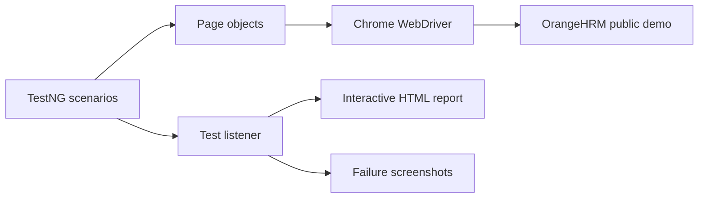

# OrangeHRM UI Automation Suite


A maintainable, Chrome-only end-to-end UI automation suite for the [OrangeHRM public demo](https://opensource-demo.orangehrmlive.com/). It uses Java, Selenium WebDriver, TestNG, and Maven to exercise key authentication, navigation, and search workflows.

The framework is organized around the Page Object Model, explicit waits, configurable browser execution, and an interactive HTML report with recorded test steps and failure evidence. It is designed as a practical example of how to structure and run UI checks locally, from VS Code, and in CI.

## Project at a glance

| | |
|---|---|
| Scenarios | 19 checks across authentication, navigation, and list search |
| Browser | Google Chrome only |
| Language | Java 17+ |
| Test runner | TestNG |
| Build | Maven |
| CI | GitHub Actions |

## Coverage

| Area | Scenarios |
|---|---|
| Authentication | Successful login and logout, invalid password, unknown username, required-field validation, and password-reset navigation/cancel |
| Module navigation | Admin, PIM, Leave, Time, Recruitment, My Info, Performance, and Directory |
| List search | Submit and reset default filters in Admin, PIM, Leave, Recruitment, Performance, and Directory |

The suite focuses on smoke and regression checks for the public demo. Search workflows use default filters and do not create, edit, or delete HR records. The demo is shared; availability, access, and seeded data can change over time.

## Framework layout



## Prerequisites

- JDK 17 or newer
- Maven 3.9 or newer
- Google Chrome

Selenium Manager resolves a compatible ChromeDriver automatically. A separate driver download or path configuration is not required. The first run needs network access to download Maven dependencies and resolve the driver.

## Run the suite

From a terminal in the project folder:

```bash
mvn clean test
```

Run with a visible Chrome window:

```bash
mvn clean test -Dheadless=false
```

The browser target and credentials can be overridden with Maven properties:

```bash
mvn clean test -DbaseUrl=https://opensource-demo.orangehrmlive.com -Dusername=Admin -Dpassword=admin123
```

Supported environment variables: `ORANGEHRM_BASE_URL`, `ORANGEHRM_USERNAME`, `ORANGEHRM_PASSWORD`, `HEADLESS`, and `SELENIUM_TIMEOUT`.

## Run from VS Code

1. Open this folder in VS Code and allow the Java project to finish importing.
2. Install the recommended **Extension Pack for Java** if prompted. The project is configured for TestNG test discovery.
3. Open the **Testing** view (beaker icon). Choose **Run Test** beside a test, class, or the suite. You can also select the green **Run Test** link above a test method in the editor.
4. Chrome runs visibly for tests launched through the VS Code Testing view.

VS Code shows execution results in the Testing view. The HTML report is refreshed as each test completes, including runs started from that view.

## Reports and failure evidence

After execution, open:

```text
target/test-reports/OrangeHRM-Test-Report.html
```

The report shows pass/fail totals, durations, failure details, and a filter. Select a test case to expand its recorded steps; failed tests include links to screenshots when available.

Additional TestNG and Surefire output is under `target/surefire-reports/`. Failure screenshots are saved under `target/screenshots/`.

## Repository structure

```text
src/
├── main/java/com/orangehrm/automation/
│   ├── config/       Runtime configuration
│   ├── driver/       Chrome WebDriver setup
│   ├── pages/        Page Object Model classes
│   └── reporting/    Test step recording
├── test/java/com/orangehrm/automation/
│   ├── base/         Shared test lifecycle
│   ├── listeners/    Test listener and report generation
│   └── tests/        Authentication, navigation, and search scenarios
└── test/resources/   TestNG suite configuration
.github/workflows/    GitHub Actions workflow
```

## Continuous integration

The GitHub Actions workflow runs the suite on pushes and pull requests using Java 17 and headless Chrome. It uploads execution reports and screenshots as workflow artifacts. CI requires network access for Maven dependencies and Selenium Manager's ChromeDriver resolution.

## Configuration note

The public demo credentials are defaults for this demo only. Override them when targeting another OrangeHRM environment, and keep private credentials out of source control.
